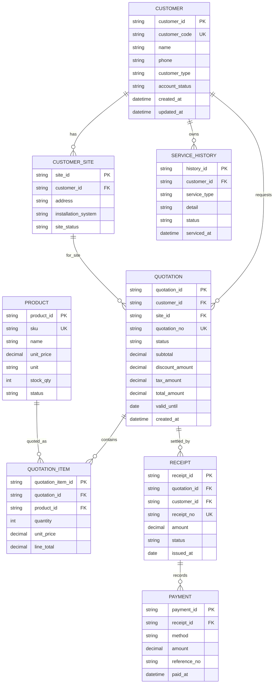

# ERD & Data Mapping: Customer / Quotation / Receipt

เอกสารนี้ออกแบบจากหน้า **ระบบจัดการข้อมูลลูกค้าและประวัติการบริการ** และ workflow ที่ UI รองรับ:

- เพิ่มและแก้ไขข้อมูลลูกค้า
- เลือกลูกค้าเพื่อดูข้อมูลแบบ master-detail
- สร้างใบเสนอราคาจากรายการสินค้า
- ออกใบเสร็จจากยอดที่รับชำระ
- เก็บประวัติการบริการไว้กับลูกค้า

## ERD (logical model)



## UI-to-data mapping

| UI surface / feature | Primary entity | Fields mapped | Behavior |
| --- | --- | --- | --- |
| รายการลูกค้าด้านซ้าย | `CUSTOMER` | `customer_code`, `name`, `phone`, `location`, `customer_type`, `account_status` | ค้นหา/กรองตามประเภทและสถานะ แล้วเลือก customer เพื่อเปิดรายละเอียด |
| เพิ่มลูกค้าใหม่ | `CUSTOMER`, `CUSTOMER_SITE` | `name`, `phone`, `customer_type`, `location`, `installation_system` | Modal validate ชื่อ/เบอร์โทร แล้วสร้าง `customer_code` ใหม่ |
| แก้ไขข้อมูลลูกค้า | `CUSTOMER`, `CUSTOMER_SITE` | ฟิลด์ข้อมูลลูกค้าที่แก้ไขได้ | โหลดข้อมูลของลูกค้าที่เลือกเข้าฟอร์มแล้วบันทึกกลับ record เดิม |
| แท็บข้อมูลลูกค้า | `CUSTOMER`, `CUSTOMER_SITE`, `SERVICE_HISTORY` | `account_status`, `installation_system`, `serviced_at`, `service_type`, `detail`, `status` | แสดงข้อมูลระบบติดตั้งและประวัติบริการล่าสุด |
| แท็บใบเสนอราคา | `QUOTATION`, `QUOTATION_ITEM`, `PRODUCT` | `quotation_no`, `customer_id`, `sku`, `quantity`, `unit_price`, `line_total`, `total_amount` | เลือกสินค้า เพิ่มจำนวน คำนวณยอดรวม และบันทึกใบเสนอราคา |
| ปุ่ม “ทำใบเสนอราคา” | `CUSTOMER` → `QUOTATION` | `customer_id`, `site_id` | เปิด workspace ใบเสนอราคาโดยคง context ของลูกค้าที่เลือก |
| แท็บใบเสร็จ | `RECEIPT`, `PAYMENT`, `QUOTATION`, `CUSTOMER` | `receipt_no`, `quotation_id`, `amount`, `status`, `issued_at`, `method` | แสดงยอดที่รับชำระ และออกเลขที่ใบเสร็จเมื่อกดยืนยัน |

## State transition

```text
Customer active
    -> Quotation draft
    -> Quotation saved / accepted
    -> Payment recorded
    -> Receipt issued
```

สถานะที่แนะนำ:

- `QUOTATION`: `DRAFT`, `SENT`, `ACCEPTED`, `EXPIRED`, `CANCELLED`
- `RECEIPT`: `PENDING`, `ISSUED`, `VOID`
- `PAYMENT`: `PENDING`, `PAID`, `REFUNDED`

## Backend alignment

| Schema ปัจจุบัน | ERD entity | สิ่งที่ควรเพิ่ม |
| --- | --- | --- |
| `Customer` | `CUSTOMER` | เปลี่ยน `id` เป็น `customer_id`, เพิ่ม `customer_code` unique, `customer_type`, timestamps และแยก `location` ไป `CUSTOMER_SITE` เมื่อมีหลายไซต์ |
| `Product` | `PRODUCT` | ใช้ `sku`, `name`, `price` เป็นฐาน และเพิ่ม `product_id`, `unit`, `supplier_id`, `reorder_point`, `status` |
| `CatalogSummary` | Dashboard read model | คำนวณจาก `PRODUCT`/Stock ledger แทนค่าคงที่ |

## Data rules

- `customer_code`, `quotation_no`, และ `receipt_no` ต้องไม่ซ้ำกัน
- `QUOTATION_ITEM.line_total = quantity * unit_price`; ราคาที่ quote ต้อง snapshot ไว้ ไม่อิงราคาสินค้าปัจจุบันย้อนหลัง
- `QUOTATION.total_amount` ควรคำนวณจากรายการสินค้า หักส่วนลด และบวกภาษีตาม policy ของระบบ
- ออก `RECEIPT` ได้เมื่อมี `PAYMENT` สถานะ `PAID` และยอดชำระผ่าน validation แล้ว
- การแก้ไขลูกค้าต้องไม่แก้ประวัติ quotation/receipt ที่ออกไปแล้ว
- เมื่อเชื่อมฐานข้อมูลจริง การเพิ่ม/แก้ไขลูกค้า, save quotation และ issue receipt ควรเป็น API transaction พร้อม audit log
