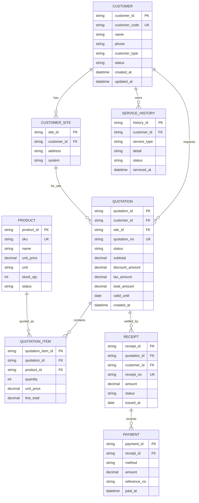

# ERD & Data Mapping: Customer / Quotation / Receipt

เอกสารนี้อ้างอิงจากหน้า **ระบบจัดการข้อมูลลูกค้าและประวัติการบริการ** และ workflow ที่ UI รองรับในปัจจุบัน:

- เพิ่มและแก้ไขข้อมูลลูกค้า
- เลือกลูกค้าเพื่อดูข้อมูลแบบ master-detail
- สร้างใบเสนอราคาจากรายการสินค้า
- ออกใบเสร็จจากยอดใบเสนอราคา (สถานะอยู่ใน state ของหน้า)
- เก็บประวัติการบริการไว้กับลูกค้า

## ERD (logical model)



## UI-to-data mapping

| UI surface / feature | Primary entity | Fields mapped | Behavior |
| --- | --- | --- | --- |
| รายการลูกค้าด้านซ้าย | `CUSTOMER` | `id`, `code`, `name`, `phone`, `email`, `location`, `customer_type`, `status` | ค้นหาด้วยชื่อ/รหัส/เบอร์/อีเมล/ผู้ติดต่อ และกรองประเภท/สถานะ |
| เพิ่มลูกค้าใหม่ | `CUSTOMER` | `name`, `phone`, `contactName`, `email`, `taxId`, `type`, `address` | บังคับชื่อและเบอร์โทร; ลูกค้าธุรกิจต้องมีชื่อผู้ติดต่อ; สร้าง code รูปแบบ `CUST-2025-###` |
| แก้ไขข้อมูลลูกค้า | `CUSTOMER` | ฟิลด์เดียวกับฟอร์มเพิ่มลูกค้า | โหลดลูกค้าที่เลือกเข้า modal แล้วแก้ไข record เดิม |
| แท็บข้อมูลลูกค้า | `CUSTOMER`, งานขาย/ติดตั้ง/บริการ | `system`, `salesHistory`, `installationHistory`, `serviceHistory` | แสดงระบบติดตั้งและประวัติตาม customer code/ชื่อ |
| แท็บใบเสนอราคา | `QUOTATION`, `QUOTATION_ITEM`, `PRODUCT` | `sku`, `name`, `qty`, `price`, `line_total`, `total` | เลือกสินค้าจาก inventory API เพิ่มจำนวน และรวมยอดจาก `price × qty` |
| ปุ่ม “ทำใบเสนอราคา” | `CUSTOMER` → local quotation state | `customerCode`, `items`, `total` | ต้องมีสินค้าอย่างน้อย 1 รายการ แล้วเปลี่ยนไปยัง workspace ใบเสนอราคา; หน้า Customer ยังไม่ persist quotation ลง backend |
| แท็บใบเสร็จ | local receipt state | `receiptIssued`, `quoteTotal` | ออกได้เมื่อยอดใบเสนอราคาไม่เป็นศูนย์; ยังไม่มี Payment/Receipt endpoint จริง |

## State transition

```text
Customer active
    -> Quotation draft
    -> Quotation saved
    -> Receipt flag set in UI
```

สถานะที่มีใน UI/ข้อมูลปัจจุบัน:

- `QUOTATION`: `DRAFT`, `SENT`, `ACCEPTED`, `EXPIRED`, `CANCELLED`
- ลูกค้า: `ชำระครบถ้วน`, `ชำระมัดจำ`, `รอนัดตรวจเช็ก`, `รอเปิดบัญชี`
- ใบเสนอราคา: `ร่างใบเสนอราคา`
- ใบเสร็จ: ใช้ boolean `receiptIssued` ในหน้า ยังไม่มี status enum หรือเลขใบเสร็จจริง

## Backend alignment

| Schema ปัจจุบัน | ERD entity | สิ่งที่ควรเพิ่ม |
| --- | --- | --- |
| `Customer` | `CUSTOMER` | backend ส่งข้อมูลลูกค้าปัจจุบัน; frontend normalize `customer_type` เป็น `type` และใช้ `address`/`location` |
| `Product` | `PRODUCT` | ใช้ `sku`, `name`, `price`, `unit` จาก inventory API สำหรับรายการใบเสนอราคา |
| `CatalogSummary` | Dashboard read model | คำนวณจาก `PRODUCT`/Stock ledger แทนค่าคงที่ |

## Data rules

- `customer.code` และเลขเอกสาร quotation/receipt (เมื่อเพิ่ม persistence) ต้องไม่ซ้ำกัน
- `QUOTATION_ITEM.line_total = quantity * unit_price`; ราคาที่ quote ต้อง snapshot ไว้ ไม่อิงราคาสินค้าปัจจุบันย้อนหลัง
- `QUOTATION.total_amount` ควรคำนวณจากรายการสินค้า หักส่วนลด และบวกภาษีตาม policy ของระบบ
- ปัจจุบันออกใบเสร็จใน UI ได้เมื่อ `quoteTotal > 0`; หากทำ persistence จริงควรเพิ่ม Payment/Receipt transaction และเลขเอกสาร
- การแก้ไขลูกค้าต้องไม่แก้ประวัติ quotation/receipt ที่ออกไปแล้ว
- เมื่อเชื่อมฐานข้อมูลจริง การเพิ่ม/แก้ไขลูกค้า, save quotation และ issue receipt ควรเป็น API transaction พร้อม audit log
