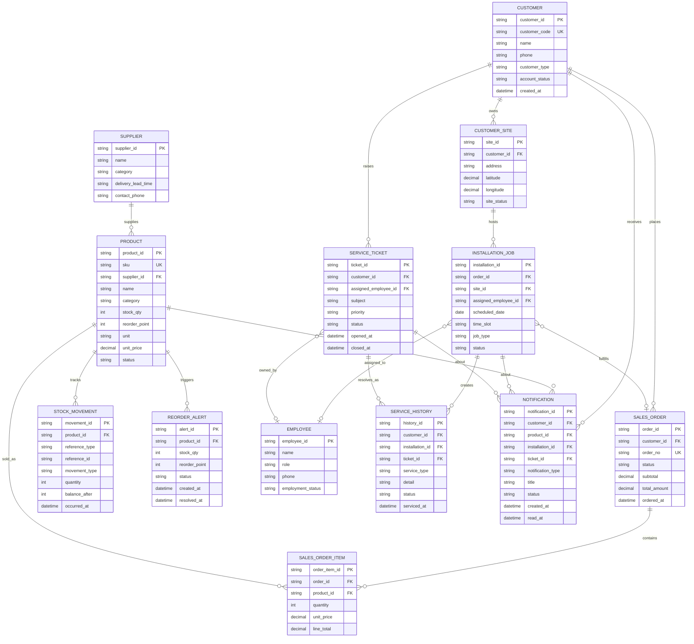

# ERD & Data Mapping: Customer / Sales / Installation / After-sales

เอกสารนี้อ้างอิง workflow ที่แสดงใน UI ของ RT Sync Solar Workbench และสถานะข้อมูลที่ใช้งานจริงในปัจจุบัน:

1. ขายสินค้าและออกใบเสนอราคา/คำสั่งขาย
2. นัดหมายและติดตามงานติดตั้ง
3. เติม Stock และสร้างรายการจัดซื้อเมื่อ Stock ต่ำกว่าหรือเท่ากับ Reorder Point
4. บริการหลังการขายและประวัติการบริการ
5. โปรไฟล์ลูกค้าแบบ master-detail ที่เชื่อมทุกกิจกรรมเข้าด้วยกัน

สำหรับหน้า Supplier รองรับการเพิ่ม Supplier ผ่าน API, แก้ไขข้อมูลใน state ของหน้า, ผูก/ถอด SKU และติดตาม Purchase Order ใน mockDb

## ERD (logical model)

## UI-to-data mapping

| UI surface / feature | Primary entities | Fields used | Key behavior |
| --- | --- | --- | --- |
| `/customers` customer list | `CUSTOMER` | `id`, `code`, `name`, `phone`, `email`, `customer_type`, `status`, `address` | Filter by type/status; search name/code/phone/email/contact; select customer to show detail |
| `/suppliers` supplier directory | `SUPPLIER`, `PRODUCT`, `PURCHASE_ORDER` | `id`, `name`, `category`, `description`, `delivery`, `sku_count`, `supplierId`, `status` | Add Supplier via API; edit Supplier, bind/unbind SKU, and update purchase-order status in mockDb |
| Customer detail / service history | `CUSTOMER`, `SERVICE_HISTORY`, `INSTALLATION_JOB`, `SERVICE_TICKET` | `system`, `service_type`, `detail`, `serviced_at`, `status` | Timeline combines installation and after-sales activities |
| Sales tab | `SALES_ORDER`, `SALES_ORDER_ITEM`, `PRODUCT` | `order_no`, `customer_id`, `sku`, `quantity`, `unit_price`, `line_total`, `total_amount` | Add catalog items to draft quote; save order; preserve customer context |
| Installation appointment tab | `INSTALLATION_JOB`, `EMPLOYEE`, `CUSTOMER` | `id`, `customer`, `site`, `date`, `time`, `employees`, `crew`, `type`, `status` | Create appointment; statuses: `รอยืนยัน` → `ยืนยันแล้ว` → `เตรียมอุปกรณ์` → `กำลังติดตั้ง` → `เสร็จสิ้น` |
| After-sales tab | `SERVICE_TICKET`, `EMPLOYEE`, `CUSTOMER` | `id`, `customer`, `site`, `date`, `time`, `subject`, `priority`, `owner`, `employees`, `status` | Open/assign/edit service ticket; statuses include `รอเปิดงาน`, `รอมอบหมาย`, `นัดหมายแล้ว`, `ยืนยันแล้ว`, `กำลังเข้าบริการ`, `เสร็จสิ้น` |
| Inventory product table | `PRODUCT`, `SUPPLIER`, `STOCK_MOVEMENT` | `sku`, `name`, `category`, `stock_qty`, `unit`, `unit_price`, `supplier_id` | Register/edit product; receive stock; maintain movement ledger |
| Reorder Point tab | `PRODUCT`, `REORDER_ALERT`, `SUPPLIER` | `stock_qty`, `reorder_point`, `status`, `supplier_id` | Alert when `stock_qty <= reorder_point`; create purchasing request |
| Fuel claims page | `FUEL_CLAIM`, `EMPLOYEE`, `INSTALLATION_JOB`, `SERVICE_TICKET` | `id`, `source`, `employee`, `job`, `vehicle`, `route`, `date`, `amount`, `receipt`, `status` | เปิด/แก้ไขรายการเบิกค่าน้ำมันและกรองสถานะ; ใช้ข้อมูลจาก mockDb |

## Existing API alignment

The current backend schemas are a starting point and map as follows:

| Existing schema | ERD entity | Notes |
| --- | --- | --- |
| `Customer` | `CUSTOMER` | Add `customer_code` uniqueness and `created_at` when persistence is introduced |
| `Product` | `PRODUCT` | Add `reorder_point`, `unit`, `supplier_id`, and `status` to support the inventory UI and supplier binding |
| `Supplier` | `SUPPLIER` | Existing `delivery` is the UI label; contact/payment fields and product relation are not fully persisted in backend |
| `Employee` | `EMPLOYEE` | Existing payroll fields remain in employee/payroll domain; installation/service uses the same employee key |
| `CatalogSummary` | Read model / dashboard projection | Should be computed from `PRODUCT` and `STOCK_MOVEMENT`, not hard-coded |

## Recommended constraints and rules

- `customer_code`, `sku`, `order_no`, and `ticket_id` must be unique.
- `SALES_ORDER_ITEM.line_total = quantity * unit_price`; `SALES_ORDER.total_amount` is the sum of line totals plus any tax/discount policy.
- Stock changes must create a `STOCK_MOVEMENT`; do not update `PRODUCT.stock_qty` without an auditable reference.
- Create or keep one active `REORDER_ALERT` per product while `stock_qty <= reorder_point`; resolve it after stock rises above the point.
- An `INSTALLATION_JOB` should reference a `CUSTOMER_SITE`, even when a customer has only one site today.
- Closing a `SERVICE_TICKET` should write one `SERVICE_HISTORY` record and store `closed_at`.
- Header notification panel/notification entity is not currently implemented in the shown views; add it only when a notification UI/API is introduced.

## Suggested implementation sequence

1. Extend Pydantic schemas and repositories with the entities/fields above.
2. Add REST resources for orders, order items, installation jobs, service tickets, stock movements, and notifications.
3. Replace mock arrays in the Vue views with API composables while retaining the current optimistic UI feedback.
4. Add database indexes on `customer_id`, `status`, `scheduled_date`, `product_id`, and `created_at`.
