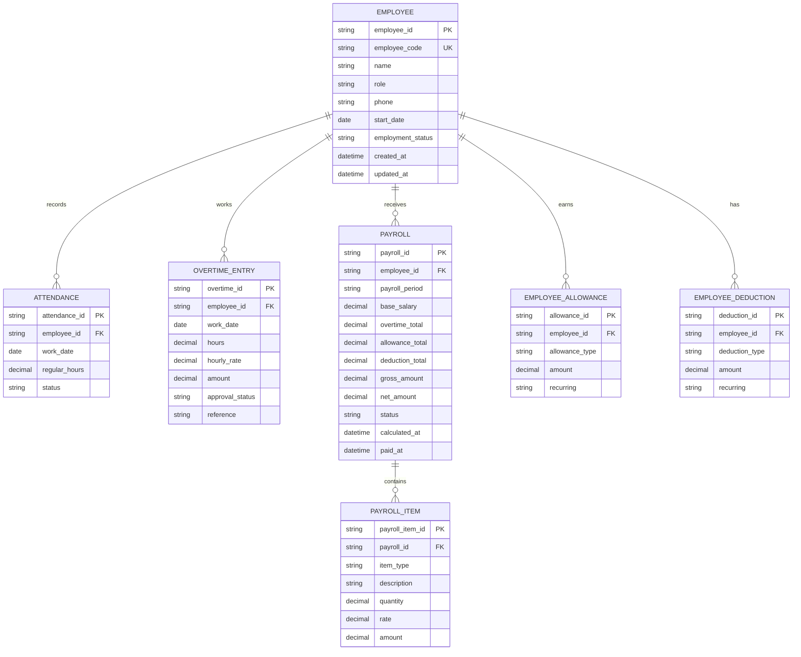

# ERD & Data Mapping: Employee / Payroll / Overtime

เอกสารนี้ออกแบบจากหน้า **ค่าตอบแทนและ OT พนักงาน** และ workflow ที่ UI รองรับ:

- เพิ่มและแก้ไขข้อมูลพนักงาน
- จัดเก็บเงินเดือนพื้นฐาน
- บันทึกชั่วโมง OT และอัตรา OT ต่อชั่วโมง
- บันทึกค่าเบี้ยเลี้ยง/ค่าจ้างเพิ่มเติมและรายการหัก
- คำนวณค่าแรง ค่าล่วงเวลา ค่าจ้างรวม และค่าจ้างสุทธิรายเดือน

## ERD (logical model)



## UI-to-data mapping

| UI surface / feature | Primary entities | Fields mapped | Behavior |
| --- | --- | --- | --- |
| รายชื่อพนักงาน | `EMPLOYEE` | `employee_id`, `name`, `role`, `employment_status` | ค้นหาและเลือกพนักงานเพื่อเปิดรายละเอียด Payroll |
| เพิ่มพนักงาน | `EMPLOYEE`, `EMPLOYEE_ALLOWANCE`, `EMPLOYEE_DEDUCTION` | `name`, `role`, `salary`, `allowance`, `deduction` | Modal validate ชื่อ/ตำแหน่ง แล้วสร้าง employee record ใหม่ |
| แก้ไขข้อมูลพนักงาน | `EMPLOYEE`, compensation inputs | ข้อมูลพนักงานและค่าตอบแทนที่แก้ไขได้ | โหลดข้อมูลของพนักงานที่เลือกเข้า form และบันทึกกลับ record เดิม |
| ข้อมูลเงินเดือนพื้นฐาน | `EMPLOYEE`, `PAYROLL` | `base_salary`, `payroll_period` | แสดงฐานเงินเดือนของรอบปัจจุบัน |
| ข้อมูล OT | `OVERTIME_ENTRY`, `PAYROLL_ITEM` | `hours`, `hourly_rate`, `amount`, `approval_status` | คำนวณ `OT amount = hours × hourly_rate` และแสดงสถานะรอตรวจสอบ |
| ค่าเบี้ยเลี้ยง/ค่าจ้างเพิ่ม | `EMPLOYEE_ALLOWANCE`, `PAYROLL_ITEM` | `allowance_type`, `amount` | รวมเข้า gross pay ของรอบเดือน |
| รายการหัก | `EMPLOYEE_DEDUCTION`, `PAYROLL_ITEM` | `deduction_type`, `amount` | หักจาก gross pay ก่อนคำนวณ net pay |
| ปุ่ม “คำนวณค่าจ้าง” | `PAYROLL` | `base_salary`, `overtime_total`, `allowance_total`, `deduction_total`, `gross_amount`, `net_amount` | สรุปยอดก่อนหักและค่าจ้างสุทธิ พร้อม feedback ให้ผู้ใช้ |
| KPI หน้า Payroll | `EMPLOYEE`, `OVERTIME_ENTRY`, `PAYROLL` | count employee, sum OT hours, sum OT amount, sum net amount | ควรเป็น aggregate query ตาม payroll period ไม่ใช่ค่าคงที่ |

## Calculation rules

```text
overtime_amount = overtime_hours × overtime_hourly_rate
gross_amount = base_salary + overtime_total + allowance_total
net_amount = gross_amount - deduction_total
```

ข้อควรระวัง:

- ควร snapshot อัตรา OT และเงินเดือนลงใน `PAYROLL_ITEM` ทุกครั้งที่คำนวณ เพื่อไม่ให้ข้อมูลย้อนหลังเปลี่ยนตาม master data
- OT ที่ยังไม่ผ่านการอนุมัติควรแสดงสถานะ `PENDING_APPROVAL` และไม่รวมในยอดจ่ายจริงจนกว่าจะอนุมัติ
- หากมีหลายประเภทค่าแรง เช่น รายวัน/รายชั่วโมง ให้เพิ่ม `pay_rate_type` และ `regular_hours` ใน Payroll calculation
- Payroll ที่สถานะ `PAID` ไม่ควรแก้ไขโดยตรง ให้ใช้ adjustment/reversal record แทน

## State transition

```text
Employee active
    -> Payroll draft
    -> Calculated
    -> Pending approval
    -> Approved
    -> Paid
```

## Backend alignment

| Schema ปัจจุบัน | ERD entity | สิ่งที่ควรเพิ่ม |
| --- | --- | --- |
| `Employee.id` | `EMPLOYEE.employee_id` | `employee_code`, `phone`, `start_date`, `employment_status`, timestamps |
| `Employee.salary` | `PAYROLL.base_salary` | ย้ายค่าจ้างตามรอบไป Payroll และเก็บประวัติการเปลี่ยนแปลง |
| `Employee.overtime_hours` | `OVERTIME_ENTRY.hours` | เพิ่มวันที่ทำ OT, rate, amount, approval status และ reference |

ปัจจุบัน repository เป็น mock data และ UI คำนวณฝั่ง client เพื่อให้ทดสอบ workflow ได้ เมื่อเชื่อมฐานข้อมูลจริงควรใช้ API transaction สำหรับการบันทึก Employee, บันทึก OT, คำนวณ Payroll และอนุมัติการจ่าย พร้อม index ที่ `employee_id`, `payroll_period`, `approval_status` และ `status`.
