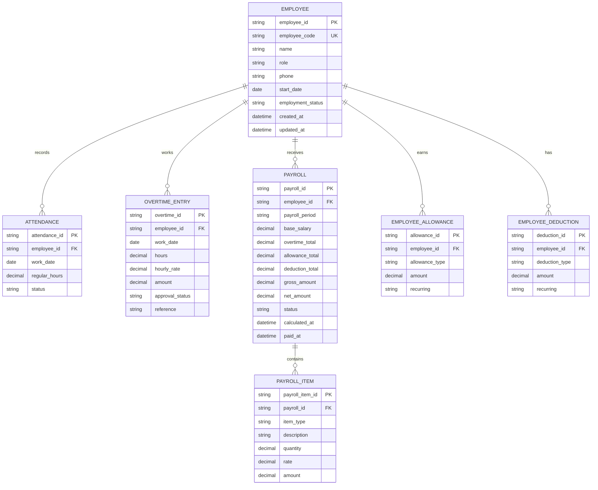

# ERD & Data Mapping: Employee / Payroll / Overtime

เอกสารนี้อ้างอิงจากหน้า **ข้อมูลพนักงานและเงินเดือน** ใน UI ปัจจุบัน โดยระบุสิ่งที่หน้าใช้งานจริงก่อน แล้วจึงคง ERD สำหรับการขยายระบบไว้:

- เพิ่มและแก้ไขข้อมูลพนักงาน
- จัดเก็บเงินเดือนพื้นฐาน
- บันทึกเงินเดือนพื้นฐาน ค่าเบี้ยเลี้ยง และรายการหัก
- คำนวณค่าจ้างรวมและค่าจ้างสุทธิจากข้อมูลพนักงาน
- ข้อมูล OT มีอยู่ใน mock data/API normalization แต่ยังไม่มีช่องกรอกหรือรายการ OT ใน UI ปัจจุบัน

## ERD (logical model)



## UI-to-data mapping

| UI surface / feature | Primary entities | Fields mapped | Behavior |
| --- | --- | --- | --- |
| รายชื่อพนักงาน | `EMPLOYEE` | `id`, `name`, `role`, `phone`, `startDate`, `salary` | ค้นหาด้วยชื่อ/รหัส/ตำแหน่ง และเปิดรายละเอียดค่าตอบแทน |
| เพิ่มพนักงาน | `EMPLOYEE` | `name`, `role`, `phone`, `email`, `startDate`, `salary`, `allowance`, `deduction` | Modal บังคับชื่อและตำแหน่ง สร้างรหัสรูปแบบ `EMP-TH-###` |
| แก้ไขข้อมูลพนักงาน | `EMPLOYEE`, compensation inputs | ข้อมูลพนักงานและค่าตอบแทนที่แก้ไขได้ | โหลดข้อมูลของพนักงานที่เลือกเข้า form และบันทึกกลับ record เดิม |
| ข้อมูลเงินเดือนพื้นฐาน | `EMPLOYEE` | `salary` | แสดงฐานเงินเดือนจาก employee record ปัจจุบัน; ยังไม่มี payroll period |
| ข้อมูล OT | ยังไม่มี entity ที่ UI แก้ไขได้ | `otHours`, `otRate` (อ่านได้จากข้อมูลที่ normalize) | ยังไม่แสดงในตาราง/สูตร Payroll ปัจจุบัน |
| ค่าเบี้ยเลี้ยง/ค่าจ้างเพิ่ม | `EMPLOYEE` | `allowance` | รวมเข้า gross pay ของพนักงานที่เลือก |
| รายการหัก | `EMPLOYEE` | `deduction` | หักจาก gross pay ก่อนคำนวณ net pay |
| ปุ่ม “คำนวณเงินเดือน” | `EMPLOYEE` | `salary`, `allowance`, `deduction`, `gross`, `net` | คำนวณฝั่ง client และแสดง notification |
| KPI หน้า Payroll | `EMPLOYEE` | count employee, sum `salary + allowance - deduction` | แสดงพนักงานทั้งหมด, พร้อมมอบหมายงาน และค่าจ้างรวมสุทธิ |

## Calculation rules ที่ UI ใช้จริง

```text
gross_amount = salary + allowance
net_amount = gross_amount - deduction
```

ข้อควรระวัง:

- ปุ่ม “คำนวณเงินเดือน” ใน UI เป็นการคำนวณฝั่ง client และแสดง notification เท่านั้น ยังไม่มีการสร้าง Payroll record หรือรอบจ่ายจริง
- `totalNetPayroll` รวม `salary + allowance - deduction` ของพนักงานทั้งหมดที่โหลดมา
- ถ้าจะเปิดใช้ OT ต้องเพิ่มช่องกรอก รายการอนุมัติ และนำ OT ที่อนุมัติแล้วเข้า `gross_amount` ก่อนใช้งานจริง

## State transition

```text
Employee record
    -> Edit compensation inputs
    -> Client-side calculation
    -> Notification only
```

## Backend alignment

| Schema ปัจจุบัน | ERD entity | สิ่งที่ควรเพิ่ม |
| --- | --- | --- |
| `Employee.id` | `EMPLOYEE.employee_id` | `employee_code`, `phone`, `start_date`, `employment_status`, timestamps |
| `Employee.salary` | `PAYROLL.base_salary` (อนาคต) | ปัจจุบันยังเก็บและแก้ไขอยู่ใน employee record |
| `Employee.overtime_hours` | `OVERTIME_ENTRY.hours` (อนาคต) | มีใน mock data เป็น `overtime_hours` และถูก normalize เป็น `otHours` แต่ UI ยังไม่ใช้คำนวณ |

ปัจจุบัน `GET /employees` โหลดข้อมูลพนักงานจาก backend ได้ และ fallback เป็น `mockDb` เมื่อเรียก API ไม่สำเร็จ ส่วนการเพิ่ม/แก้ไขพนักงานและการคำนวณค่าจ้างยังบันทึกใน `mockDb`/localStorage ฝั่ง frontend ไม่มี endpoint สำหรับ Payroll หรือ OT โดยเฉพาะ
