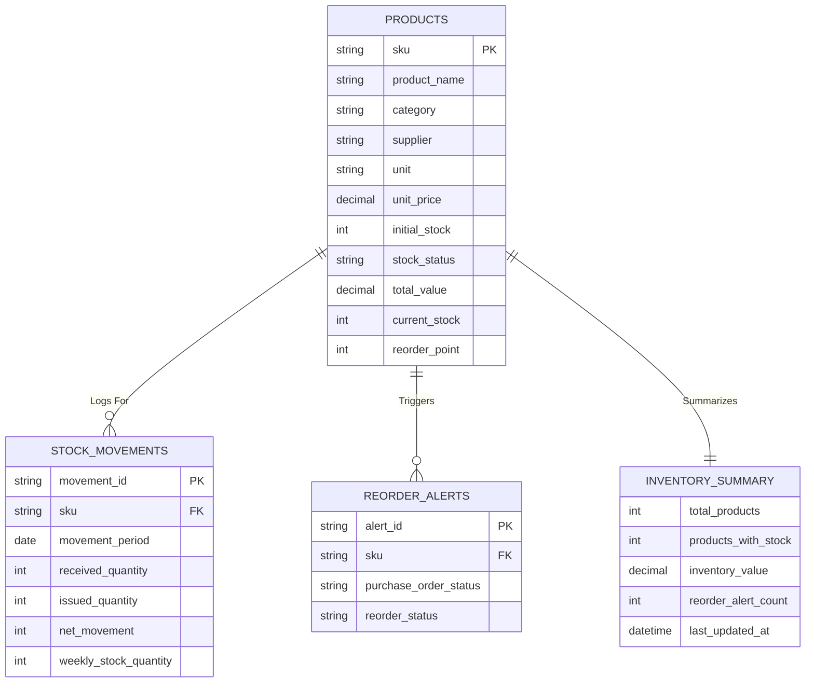

# ERD & Mapping: Product Inventory Management

เอกสารนี้จัดทำให้สอดคล้องกับ UI **จัดการข้อมูลสินค้า** และ ERD ที่แนบมา โดยใช้โครงสร้างหลัก 4 ส่วน:

- `PRODUCTS` — master data ของสินค้าและยอดคงคลังปัจจุบัน
- `STOCK_MOVEMENTS` — ประวัติการรับเข้า/เบิกออกตามช่วงเวลา
- `REORDER_ALERTS` — รายการแจ้งเตือนเมื่อสินค้าอยู่ที่หรือต่ำกว่า Reorder Point
- `INVENTORY_SUMMARY` — report view สำหรับ KPI และภาพรวมคลังสินค้า ไม่ใช่ตาราง transaction หลัก

## ERD (relational view)



## Relationship and cardinality

| Relationship | Cardinality | Meaning |
| --- | --- | --- |
| `PRODUCTS.sku` → `STOCK_MOVEMENTS.sku` | 1 : N | สินค้า 1 SKU มีรายการเคลื่อนไหว Stock ได้หลายรายการ |
| `PRODUCTS.sku` → `REORDER_ALERTS.sku` | 1 : N | สินค้า 1 SKU อาจมีประวัติ alert หลายครั้งตามรอบการสั่งซื้อ |
| `PRODUCTS` → `INVENTORY_SUMMARY` | N : 1 (report) | Summary รวมข้อมูลจากสินค้าหลายรายการเป็นภาพรวมเดียว |

> `INVENTORY_SUMMARY` เป็น derived/report view ตามภาพแนบ ไม่ควรใช้เป็นแหล่งข้อมูลหลักสำหรับแก้ไข Stock

## Field mapping: UI → database model

| UI location | UI field / label | Database field | Mapping / note |
| --- | --- | --- | --- |
| ทะเบียนสินค้า | SKU / รหัสสินค้า | `PRODUCTS.sku` | Primary key และรหัสสินค้าไม่ซ้ำ |
| ทะเบียนสินค้า | ชื่อสินค้า | `PRODUCTS.product_name` | ชื่อที่ใช้ค้นหาและแสดงในตาราง |
| ทะเบียนสินค้า | หมวดหมู่ | `PRODUCTS.category` | เช่น แผงโซลาร์, อินเวอร์เตอร์, อุปกรณ์วัด |
| ทะเบียนสินค้า | ซัพพลายเออร์ | `PRODUCTS.supplier` | ตามภาพแนบเก็บเป็น attribute ของ Product โดยตรง |
| ทะเบียนสินค้า | หน่วยนับ | `PRODUCTS.unit` | เช่น แผง, เครื่อง, ชิ้น, ม้วน |
| ทะเบียนสินค้า | ราคาต่อหน่วย | `PRODUCTS.unit_price` | ใช้คำนวณมูลค่าคงคลัง |
| modal ลงทะเบียนสินค้า | จำนวน Stock เริ่มต้น | `PRODUCTS.initial_stock` | ค่าเริ่มต้นก่อนมี movement |
| ตารางสินค้า | คงเหลือ | `PRODUCTS.current_stock` | ยอด Stock ปัจจุบัน |
| ตารางสินค้า | Reorder Point | `PRODUCTS.reorder_point` | จุดสั่งซื้อขั้นต่ำ |
| ตารางสินค้า | มูลค่า | `PRODUCTS.total_value` | มูลค่าคงคลังของ SKU นั้น |
| ตารางสินค้า | สถานะ | `PRODUCTS.stock_status` | พร้อมจำหน่าย / ต้องสั่งเพิ่ม |
| รายงาน Stock | รับเข้า | `STOCK_MOVEMENTS.received_quantity` | จำนวนรับเข้าตาม `movement_period` |
| รายงาน Stock | เบิกออก | `STOCK_MOVEMENTS.issued_quantity` | จำนวนจ่าย/เบิกออกตาม `movement_period` |
| รายงาน Stock | Movement เดือนนี้ | `STOCK_MOVEMENTS.net_movement` | ผลต่างรับเข้าและเบิกออก |
| รายงาน Stock | Stock รายสัปดาห์ | `STOCK_MOVEMENTS.weekly_stock_quantity` | ยอดที่ใช้แสดงแนวโน้มรายสัปดาห์ |
| Reorder Point | รายการต้องสั่งเพิ่ม | `REORDER_ALERTS.sku` | FK ไปยัง Product ที่เข้าเงื่อนไข |
| Reorder Point | สถานะใบสั่งซื้อ | `REORDER_ALERTS.purchase_order_status` | เช่น ยังไม่สร้าง, สร้างแล้ว, รับเข้าแล้ว |
| Reorder Point | สถานะ Reorder | `REORDER_ALERTS.reorder_status` | ปกติ / ต้องสั่งเพิ่ม |
| KPI สินค้าทั้งหมด | สินค้าทั้งหมด | `INVENTORY_SUMMARY.total_products` | จำนวน SKU ทั้งหมด |
| KPI มี Stock | สินค้ามี Stock | `INVENTORY_SUMMARY.products_with_stock` | จำนวน SKU ที่ `current_stock > 0` |
| KPI มูลค่าคงคลัง | มูลค่าคงคลัง | `INVENTORY_SUMMARY.inventory_value` | ผลรวม `PRODUCTS.total_value` |
| KPI Reorder | รายการถึง Reorder Point | `INVENTORY_SUMMARY.reorder_alert_count` | จำนวน alert ที่ยัง active |
| KPI / รายงาน | อัปเดตล่าสุด | `INVENTORY_SUMMARY.last_updated_at` | เวลา refresh summary ล่าสุด |

## Calculation and status rules

```text
current_stock = initial_stock + received_quantity - issued_quantity
total_value = current_stock × unit_price
net_movement = received_quantity - issued_quantity
```

```text
ถ้า current_stock <= reorder_point:
    stock_status = "ต้องสั่งเพิ่ม"
    reorder_status = "ต้องสั่งเพิ่ม"
ถ้า current_stock > reorder_point:
    stock_status = "พร้อมจำหน่าย"
    reorder_status = "ปกติ"
```

กติกาเพิ่มเติม:

- `current_stock`, `total_value`, `net_movement` และ `stock_status` เป็นค่าคำนวณ ไม่ควรแก้โดยตรงจาก report view
- ทุกการเติม Stock จาก action “เติมสินค้า” ควรสร้าง `STOCK_MOVEMENTS` รายการ `received_quantity`
- ทุกการขาย/เบิกสินค้า ควรสร้าง `STOCK_MOVEMENTS` รายการ `issued_quantity`
- การสร้าง alert ควรป้องกัน active alert ซ้ำสำหรับ SKU เดียวกันในรอบเดียวกัน
- เมื่อรับสินค้าเข้าและ `current_stock > reorder_point` ให้เปลี่ยน `reorder_status` เป็น `ปกติ` หรือปิด alert เดิม

## Mapping กับหน้าจอปัจจุบัน

| UI section | Source | Output |
| --- | --- | --- |
| ทะเบียนสินค้า | `PRODUCTS` | ตาราง SKU, สินค้า, หมวดหมู่, Stock, Reorder Point, มูลค่า, สถานะ |
| รายงาน Stock | `PRODUCTS` + `STOCK_MOVEMENTS` | Stock แยกหมวดหมู่, movement เดือนนี้, trend รายสัปดาห์ |
| Reorder Point | `PRODUCTS` + `REORDER_ALERTS` | การ์ดสินค้าที่ต่ำกว่าหรือเท่ากับจุดสั่งซื้อ และ action สร้างรายการสั่งซื้อ |
| KPI cards | `INVENTORY_SUMMARY` | สินค้าทั้งหมด, มูลค่าคงคลัง, จำนวนรายการ Reorder |
| ค้นหา/กรอง | `PRODUCTS.sku`, `product_name`, `category` | กรองในทะเบียนสินค้าโดยไม่เปลี่ยนความสัมพันธ์ของข้อมูล |

## Backend/API recommendation

เพื่อให้ตรงกับ model นี้ แนะนำ resource ดังนี้:

| Endpoint | Purpose |
| --- | --- |
| `GET /products` | รายการสินค้าและค่าคำนวณปัจจุบัน |
| `POST /products` | ลงทะเบียนสินค้า พร้อม `initial_stock` และ `reorder_point` |
| `PATCH /products/{sku}` | แก้ไข master data เช่น ชื่อ, category, supplier, ราคา, reorder point |
| `POST /products/{sku}/stock-movements` | รับเข้า/เบิกออก Stock และคำนวณ balance ใหม่ |
| `GET /stock-movements?period=...` | รายงาน movement ตามช่วงเวลา |
| `GET /reorder-alerts` | รายการ alert ที่ active |
| `POST /reorder-alerts/{alert_id}/purchase-request` | สร้างคำขอสั่งซื้อจาก alert |
| `GET /inventory-summary` | อ่าน report view สำหรับ KPI |

## Consistency note with current frontend

UI ปัจจุบันใช้ชื่อ property แบบ camelCase (`stock`, `reorderPoint`, `price`, `supplier`) ขณะที่ ERD ใช้ชื่อ database ตามภาพแนบ (`current_stock`, `reorder_point`, `unit_price`, `supplier`) ดังนั้น API mapper ควรแปลงชื่อระหว่างสองชั้น เช่น:

```text
product.stock        ↔ PRODUCTS.current_stock
product.reorderPoint ↔ PRODUCTS.reorder_point
product.price        ↔ PRODUCTS.unit_price
product.supplier     ↔ PRODUCTS.supplier
```
