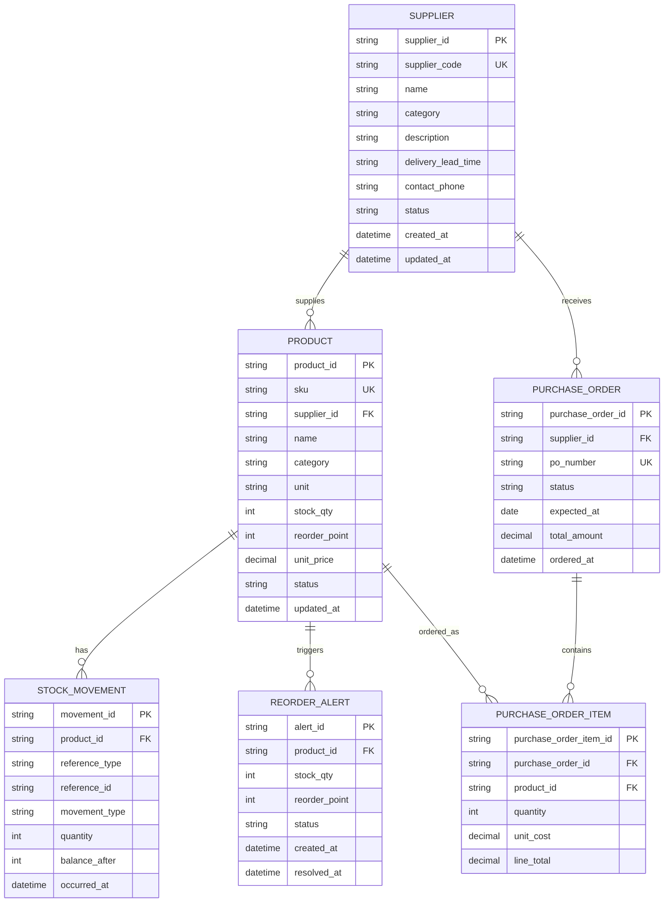

# ERD & Data Mapping: Supplier / Product Sourcing Hub

เอกสารนี้สรุปโครงสร้างข้อมูลให้ตรงกับหน้า **ศูนย์จัดการซัพพลายเออร์และสินค้า** ปัจจุบัน ซึ่งรองรับการเพิ่ม/แก้ไข Supplier, จัดการหมวดหมู่, ผูก SKU และติดตามใบสั่งซื้อ

## ERD (logical model)

## UI mapping

| หน้าจอ/ความสามารถ | Entity หลัก | Mapping สำคัญ | พฤติกรรมใน UI |
| --- | --- | --- | --- |
| รายการ Supplier ด้านซ้าย | `SUPPLIER` | `id`, `name`, `category`, `description`, `delivery`, `sku_count` | ค้นหา/กรองหมวดหมู่ และเลือก Supplier เพื่อเปิดรายละเอียด |
| เพิ่ม/แก้ไข Supplier | `SUPPLIER` | `name`, `category`, `description`, `contactName`, `contactPhone`, `contactEmail`, `delivery`, `paymentTerms` | ชื่อและหมวดหมู่เป็นข้อมูลบังคับ; category ต้องมาจากรายการที่มีอยู่หรือเพิ่มใหม่ |
| สินค้าจากซัพพลายเออร์ | `PRODUCT` → local supplier relation | `supplierId`, `sku`, `name`, `price`, `stock`, `reorderPoint`, `status` | แสดง SKU ที่ผูกกับ Supplier ที่เลือก |
| ผูกสินค้าเข้ากับ Supplier | local `PRODUCT.supplierId` | `sku`, `supplierId` | เลือก SKU ที่ยังไม่ผูก แล้วบันทึกใน `mockDb` |
| ตารางสินค้าและ Stock | `PRODUCT`, `STOCK_MOVEMENT` | `sku`, `stock_qty`, `unit_price`, `status` | ใช้ข้อมูล Supplier เดียวกันกับหน้า Inventory เพื่อไม่ให้แหล่งจัดซื้อคลาดเคลื่อน |
| Reorder / สั่งซื้อ | `PRODUCT`, `PURCHASE_ORDER`, `PURCHASE_ORDER_ITEM` | `stock <= reorderPoint`, `supplierId`, `qty`, `price` | แสดงรายการสั่งซื้อและเปลี่ยนสถานะใบสั่งซื้อในหน้า Supplier |

## กติกาข้อมูล

- `supplier.id`, `PRODUCT.sku`, และ `PURCHASE_ORDER.id` ต้องไม่ซ้ำกัน
- ใน UI ปัจจุบันสินค้า 1 SKU มี Supplier หลักได้ 1 รายผ่าน `supplierId`; การ map จาก inventory ใช้ชื่อ Supplier ไปเป็น ID ชั่วคราว
- `sku_count` ที่แสดงใน UI มาจาก backend และการ map สินค้าใน frontend; ควรคำนวณจาก relation จริงเมื่อมี persistence เต็มรูปแบบ
- การรับเข้า/จ่ายออก Stock ต้องสร้าง `STOCK_MOVEMENT` เพื่อ audit ย้อนหลังได้
- สร้าง `REORDER_ALERT` เมื่อ `stock_qty <= reorder_point` และปิด alert เมื่อ Stock สูงกว่าจุดสั่งซื้อ
- การสร้าง `PURCHASE_ORDER` ต้องดึง Supplier จากสินค้าในรายการ และไม่ควรอนุญาตให้สินค้ารายการเดียวกันอ้าง Supplier คนละรายโดยไม่ตั้งใจ

## Alignment กับ Backend ปัจจุบัน

| Schema ปัจจุบัน | Entity | สิ่งที่ควรเพิ่ม |
| --- | --- | --- |
| `Supplier` | `SUPPLIER` | backend มี `id`, `name`, `category`, `description`, `delivery`, `sku_count`; contact/payment fields ยังอยู่ใน mock/UI |
| `Product` | `PRODUCT` | backend มี `sku`, `supplier` เป็นชื่อ; frontend สร้าง `supplierId` จาก mapping ชั่วคราว |

ปัจจุบันการเพิ่ม Supplier ใช้ `POST /suppliers` ได้ ส่วนการแก้ไข Supplier, ผูก/ถอด SKU และการอัปเดตใบสั่งซื้อยังเป็น state ใน `mockDb`/localStorage จึงควรเพิ่ม API transaction และ relation `PRODUCT.supplier_id` เมื่อทำ persistence จริง
