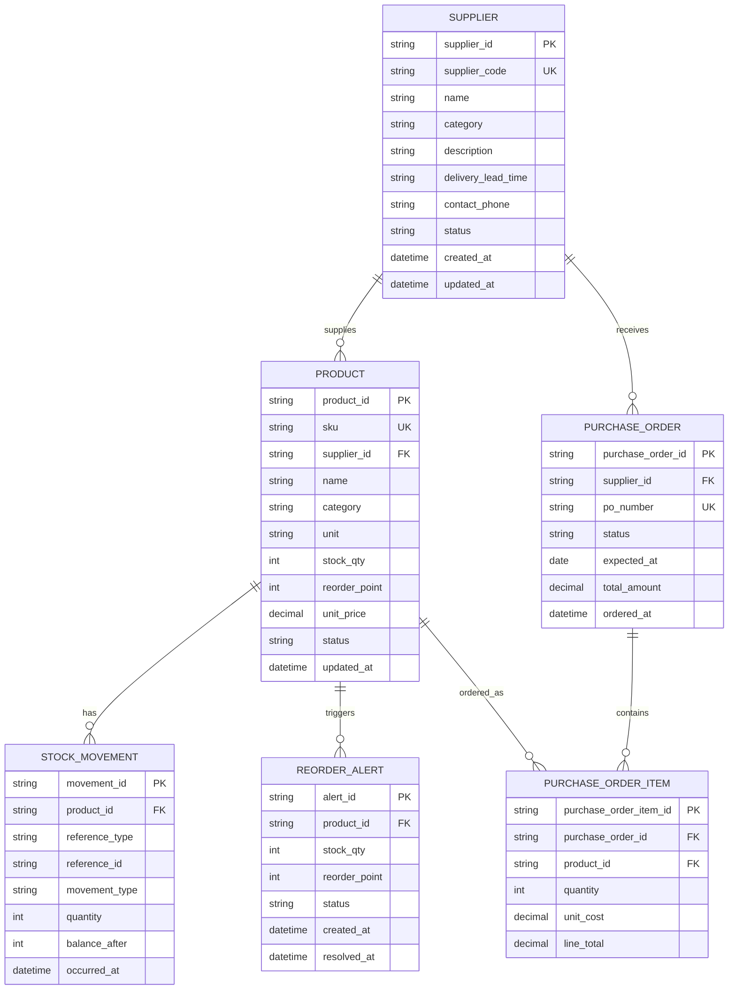

# ERD & Data Mapping: Supplier / Product Sourcing Hub

เอกสารนี้สรุปโครงสร้างข้อมูลสำหรับหน้า **ศูนย์จัดการซัพพลายเออร์และสินค้า** โดยรองรับการเพิ่ม/แก้ไข Supplier และระบุว่าสินค้าแต่ละ SKU ซื้อจาก Supplier รายใด รวมถึงข้อมูล Stock และ Reorder Point ที่ใช้ประกอบการสั่งซื้อ

## ERD (logical model)

## UI mapping

| หน้าจอ/ความสามารถ | Entity หลัก | Mapping สำคัญ | พฤติกรรมใน UI |
| --- | --- | --- | --- |
| รายการ Supplier ด้านซ้าย | `SUPPLIER` | `supplier_id`, `name`, `category`, `description`, `delivery_lead_time`, `sku_count` | ค้นหาและเลือก Supplier เพื่อเปิดรายละเอียด |
| เพิ่ม Supplier | `SUPPLIER` | `name`, `category`, `description`, `delivery_lead_time` | เปิด modal, validate ชื่อ/หมวดหมู่, บันทึก Supplier ใหม่ |
| แก้ไข Supplier | `SUPPLIER` | ทุกฟิลด์ข้อมูล Supplier ที่แก้ไขได้ | โหลดค่าของ Supplier ที่เลือกเข้า form แล้วบันทึกกลับรายการเดิม |
| สินค้าจากซัพพลายเออร์ | `PRODUCT` → `SUPPLIER` | `PRODUCT.supplier_id = SUPPLIER.supplier_id` | แสดง SKU, ชื่อสินค้า, ราคา, Stock, Reorder Point และสถานะ |
| ผูกสินค้าเข้ากับ Supplier | `PRODUCT.supplier_id` | `product_id`/`sku`, `supplier_id` | เลือก SKU จาก dropdown แล้วบันทึกแหล่งจัดซื้อของ SKU นั้น |
| ตารางสินค้าและ Stock | `PRODUCT`, `STOCK_MOVEMENT` | `sku`, `stock_qty`, `unit_price`, `status` | ใช้ข้อมูล Supplier เดียวกันกับหน้า Inventory เพื่อไม่ให้แหล่งจัดซื้อคลาดเคลื่อน |
| Reorder / สั่งซื้อ | `REORDER_ALERT`, `PURCHASE_ORDER`, `PURCHASE_ORDER_ITEM` | `stock_qty <= reorder_point`, `supplier_id`, `quantity`, `unit_cost` | สร้างแจ้งเตือนและต่อยอดเป็นใบสั่งซื้อของ Supplier ที่ผูกไว้ |

## กติกาข้อมูล

- `supplier_code`, `sku`, และ `po_number` ต้องไม่ซ้ำกัน
- สินค้าหนึ่ง SKU ควรมี Supplier หลักได้หนึ่งรายใน `PRODUCT.supplier_id`; หากรองรับหลาย Supplier ให้เพิ่มตาราง `PRODUCT_SUPPLIER` แทนการเก็บ FK ตรง
- `sku_count` เป็นค่าคำนวณจากจำนวน `PRODUCT` ที่มี `supplier_id` ตรงกับ Supplier ไม่ควรเก็บซ้ำถ้าไม่จำเป็น
- การรับเข้า/จ่ายออก Stock ต้องสร้าง `STOCK_MOVEMENT` เพื่อ audit ย้อนหลังได้
- สร้าง `REORDER_ALERT` เมื่อ `stock_qty <= reorder_point` และปิด alert เมื่อ Stock สูงกว่าจุดสั่งซื้อ
- การสร้าง `PURCHASE_ORDER` ต้องดึง Supplier จากสินค้าในรายการ และไม่ควรอนุญาตให้สินค้ารายการเดียวกันอ้าง Supplier คนละรายโดยไม่ตั้งใจ

## Alignment กับ Backend ปัจจุบัน

| Schema ปัจจุบัน | Entity | สิ่งที่ควรเพิ่ม |
| --- | --- | --- |
| `Supplier` | `SUPPLIER` | `supplier_code`, `description`, `contact_phone`, `status`, timestamps |
| `Product` | `PRODUCT` | `supplier_id`, `unit`, `reorder_point`, `status`, timestamps |

ปัจจุบัน repository เป็น mock data ดังนั้น UI ที่เพิ่ม/แก้ไข/ผูกสินค้าเป็น state ฝั่งหน้าเว็บก่อน เมื่อเชื่อมฐานข้อมูลจริงให้ย้าย action เหล่านี้ไปเป็น API transaction และสร้าง index ที่ `SUPPLIER.name`, `PRODUCT.sku`, `PRODUCT.supplier_id`, และ `REORDER_ALERT.status`.
